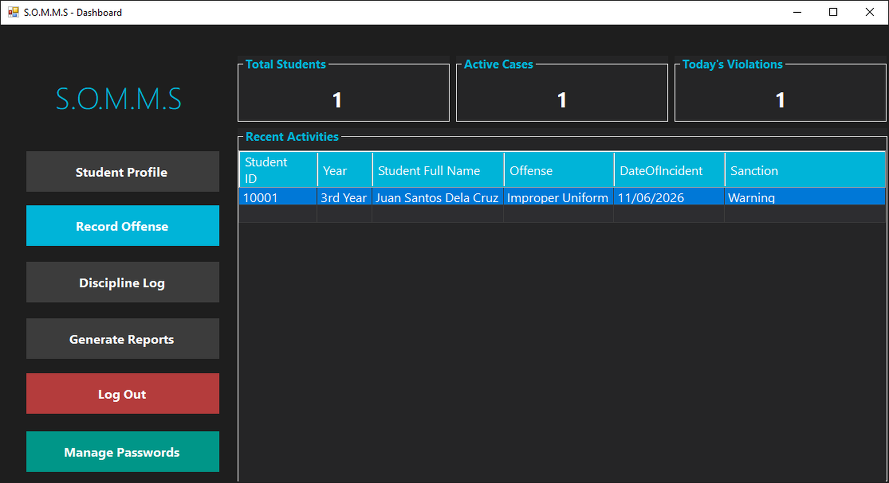
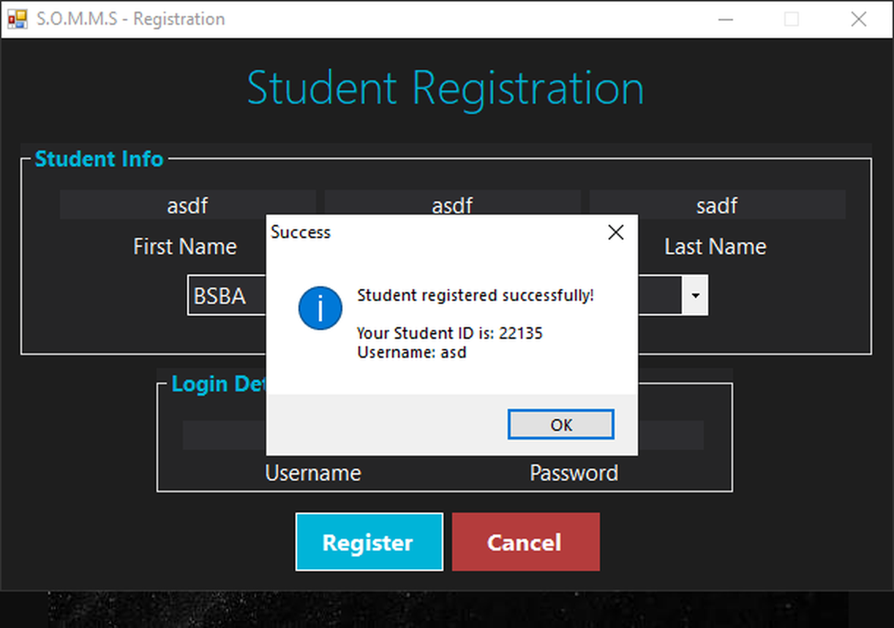
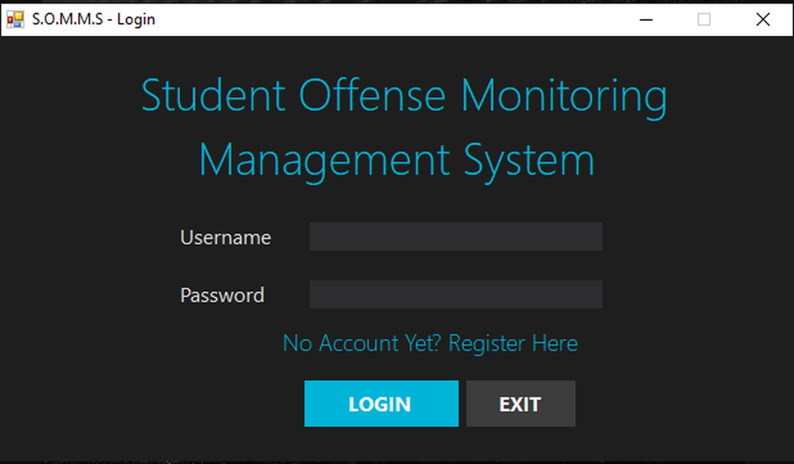
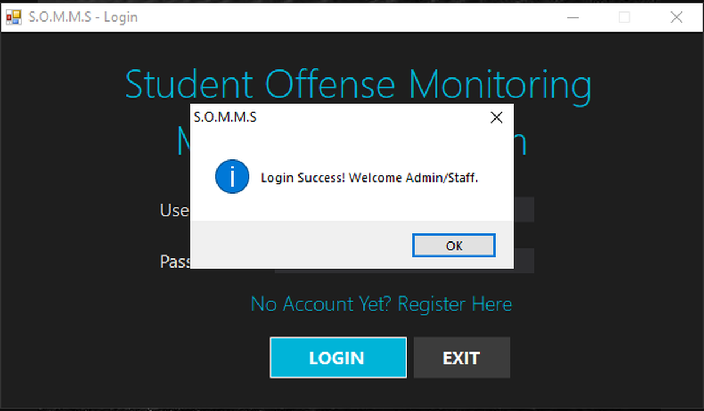
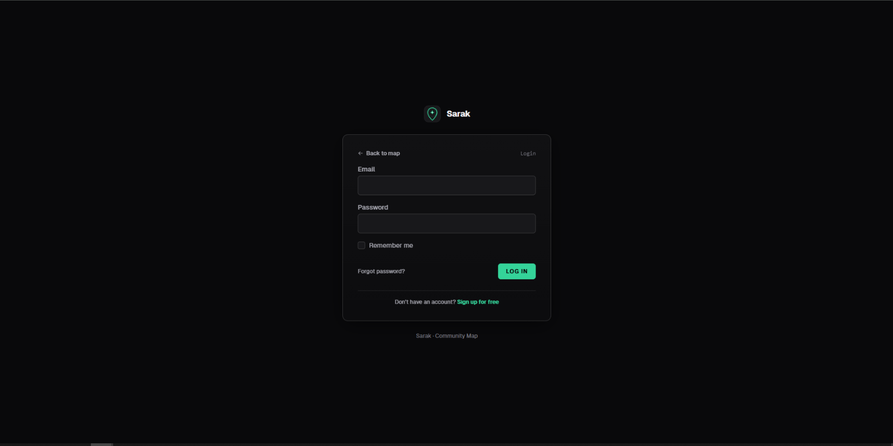
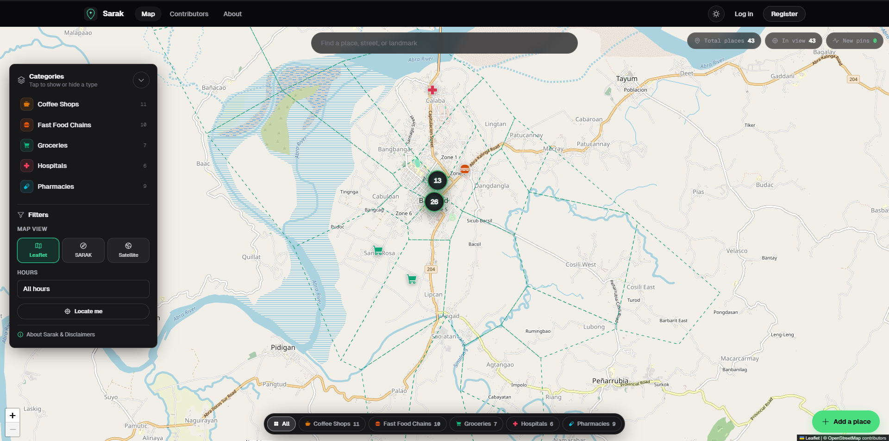
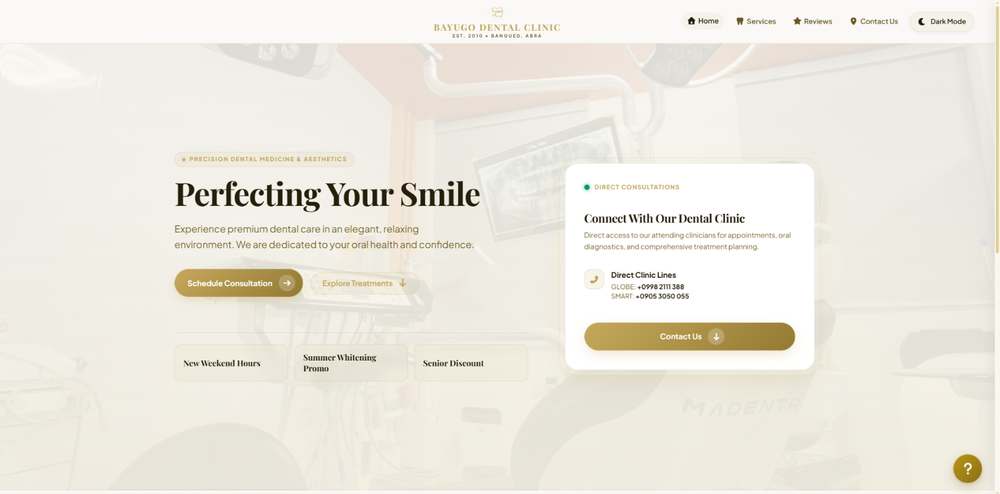
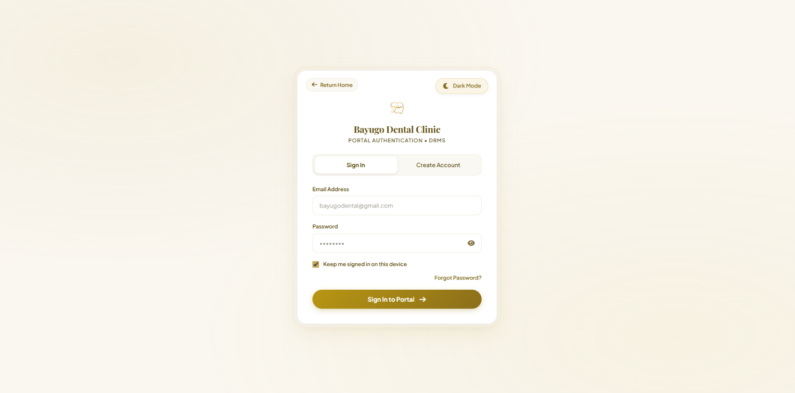
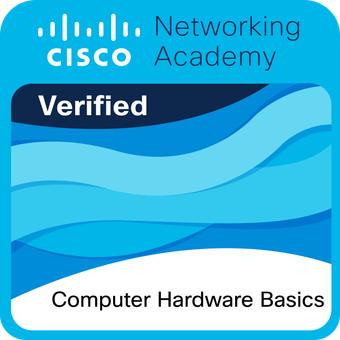
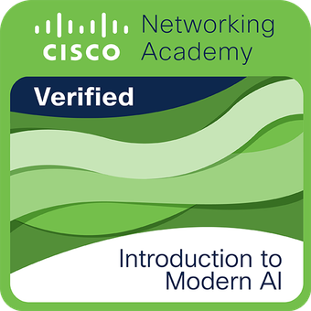

<div align="center">

# 🎬 laraprof — Developer Portfolio

<p align="center">
  <strong>An immersive developer portfolio showcasing my projects.</strong>
</p>

<p align="center">
  <a href="https://sprout.free.nf">
    
  </a>
  <a href="https://laravel.com">
    
  </a>
  <a href="https://php.net">
    
  </a>
  <a href="https://tailwindcss.com">
    
  </a>
  <a href="https://motion.dev">
    
  </a>
</p>

<p align="center">
  <a href="#-project-overview">Overview</a> •
  <a href="#-featured-systems-showcase">Featured Systems</a> •
  <a href="#-credentials--certifications">Credentials</a> •
  <a href="#-technical-stack">Tech Stack</a> •
  <a href="#-local-installation">Installation</a> •
  <a href="#-deployment-architecture">Deployment</a> •
</p>

</div>

---

## 📽️ Project Overview

**laraprof** is a custom-engineered web portfolio built on the **Retro Horror Film & Midnight Grindhouse** design aesthetic. Inspired by vintage celluloid film aesthetics, the application combines rich atmosphere with modern reactive physics, WebGL particles, and high-performance server-rendered Laravel architecture.

---

## 🚀 Featured Systems Showcase

### 1. S.O.M.M.S — Student Offense Management System

An RBAC Guidance System for viewing and recording student offenses.

| Dashboard | Registration |
| :---: | :---: |
|  |  |
| **Login Page** | **Login Success** |
|  |  |

* **Tech Stack**: VB.Net & SQLite

---

### 2. SARAK — Interactive GIS made for Bangued, Abra
> **Infrastructure Mapping for Bangued**

An interactive GIS geospatial system.

| Auth Page | Navigation |
| :---: | :---: |
|  |  |

* **Tech Stack**: Leaflet GIS, GeoJSON, OpenStreetMap, PHP, Vanilla JavaScript

---

### 3. DRMS - Dental Record Management System
> **Bayugo Dental Clinic**

A sleek modern dental record and booking system with rbac.

| Landing | Auth Page |
| :---: | :---: |
|  |  |

* **Tech Stack**: Laravel, React & SQLite(migrating to mariadb on final)

---

---

## 🏆 Credentials & Certifications

<div align="center">
  <table>
    <tr>
      <td align="center" width="50%">
        <br>
        <strong>Cisco: Computer Hardware Basics</strong><br>
        <small>System Architecture & Hardware Diagnostics</small>
      </td>
      <td align="center" width="50%">
        <br>
        <strong>Cisco: Introduction to Modern AI</strong><br>
        <small>AI Architectures & Applied Machine Learning</small>
      </td>
    </tr>
  </table>
</div>

---

## 🛠️ Technical Stack

| Layer | Technologies & Tools |
|---|---|
| **Backend & Runtime** | PHP 8.2+, Laravel 12.x, Composer |
| **Frontend & Templating** | Blade Templates, HTML5 Semantic DOM |
| **CSS Architecture** | Tailwind CSS v4.0, CSS Color Module Level 4, Custom Design System |
| **Animation & Physics** | `motion` (v14.9), Kinetic Typography, Spring Interpolation |
| **Graphics & Audio** | Three.js / WebGL, HTML5 Canvas, SVG Graphics |
| **Tooling & Bundler** | Vite 7.x, PostCSS, ESLint, Git, GitHub CLI |
| **Production Hosting** | InfinityFree Shared Hosting (`sprout.free.nf`), ZeroSSL HTTPS |

---

## 💻 Local Installation

### Prerequisites
* **PHP** >= 8.2
* **Composer** >= 2.x
* **Node.js** >= 18.x & **npm**

### Step-by-Step Setup

1. **Clone the repository**:
   ```bash
   git clone https://github.com/sprout-main/laraprof.git
   cd laraprof
   ```

2. **Install PHP dependencies**:
   ```bash
   composer install
   ```

3. **Install JavaScript dependencies & build assets**:
   ```bash
   npm install
   npm run build
   ```

4. **Configure environment**:
   ```bash
   cp .env.example .env
   php artisan key:generate
   ```

5. **Start the development server**:
   ```bash
   php artisan serve
   ```
   Open [http://127.0.0.1:8000](http://127.0.0.1:8000) in your browser.

---

## 🌐 Deployment Architecture

The application is deployed live to **[sprout.free.nf](https://sprout.free.nf)** on InfinityFree using a non-destructive rewrite structure:

* The root `.htaccess` transparently routes all requests into `public/`, preserving Laravel's folder structure.
* ZeroSSL wildcard SSL certificate (`*.free.nf`) is enforced via edge proxy rewrite rules (`RewriteCond %{HTTP:X-Forwarded-Proto} =http`).
* A deploy-ready update archive ([laraprof-update.zip](laraprof-update.zip)) enables zero-downtime hot patches.

---

## 📂 Project Directory Map

```text
laraprof/
├── app/                        # Application bootstrap logic
├── config/
│   └── portfolio.php           # Single source of truth for portfolio data
├── public/
│   ├── build/                  # Compiled Vite production CSS & JS bundles
│   ├── images/
│   │   ├── certs/              # Industry certification badges and certificates
│   │   ├── projects/           # High-resolution screenshots of built systems
│   │   └── jm.jpg              # Profile avatar
│   └── .htaccess               # Laravel front controller rewrite rules
├── resources/
│   ├── css/
│   │   └── app.css             # Design tokens, CRT effects & @supports rules
│   ├── js/
│   │   ├── app.js              # Entry point & interactive UI controller
│   │   ├── motion-engine.js    # Spring physics, kinetic typography & reveals
│   │   └── webgl.js            # Ambient stardust & spectral particles
│   └── views/
│       ├── layouts/app.blade.php  # Master layout with <noscript> fallbacks
│       ├── home.blade.php         # Hero, about, skills & project showcase
│       ├── education.blade.php    # Academic timeline & certifications
│       └── experience.blade.php   # Professional history & technical arsenal
├── routes/
│   └── web.php                 # Named portfolio route definitions
└── tests/                      # Automated feature and unit test suite
```

---
